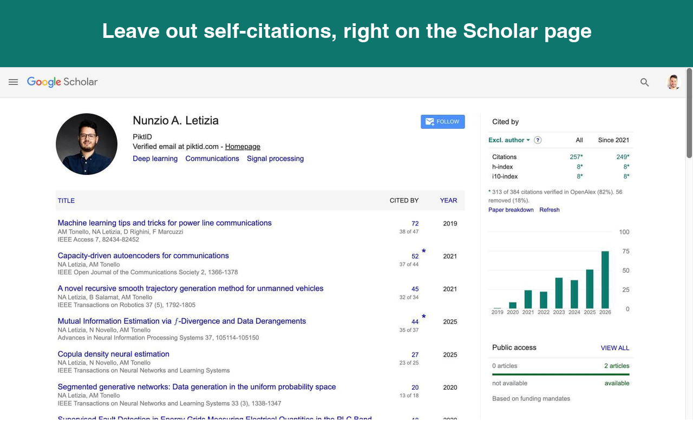

# Selfless

**Citation filters for Google Scholar.** Open a Scholar profile and see how many of its
citations come from outside the author's own circle.

**[Install from the Chrome Web Store](https://chromewebstore.google.com/detail/selfless/doeoddoeiinbljeadljoijohkbfaianb?utm_source=github)**, then open any
Google Scholar profile and pick a filter from the menu in the corner of the citation
table.

Google Scholar is the citation page most researchers actually use, but it cannot exclude
self-citations. Scopus and Web of Science can, behind a subscription and on their own
numbers. Selfless adds the missing filters to the Scholar page you are already looking at.

## The three filters

On a Scholar profile, Selfless adds a menu in the top-left corner of the citation table
("No filter", "Excl. author", "Excl. paper's authors", "Excl. network"). It leaves out
citations by one of three groups: the author, the paper's authors, or the author's
network.

Each choice leaves out citations from a wider group of people. The author is one of the
paper's authors, and the paper's authors are part of the author's network, so each
choice also removes everything the previous one removes.

| Citing paper written by | The author | The paper's authors | The author's network |
|---|---|---|---|
| The profile owner | removed | removed | removed |
| A co-author of the cited paper, without the owner | kept | removed | removed |
| Someone who co-authored *another* paper with the owner | kept | kept | removed |
| Someone with no publication link to the owner | kept | kept | kept |

1. **The author.** The profile owner wrote the citing paper. The classic "excluding
   self-citations" figure.
2. **The paper's authors.** Anyone who co-wrote the cited paper (the owner included)
   wrote the citing paper. Matters most for supervisors and group leads, who sit on many
   papers.
3. **The author's network.** Anyone the owner has ever published with (the owner
   included) wrote the citing paper. The strictest view: citations from outside the
   owner's circle.

## What you see on the page

Nothing changes until you pick a filter. Then, on the same Scholar page:

- **Citation table.** Citations, h-index and i10-index (both "All" and "Since") are
  replaced by the filtered values, shown in a different color and marked with `*`. The
  footnote under the table says what they are computed on, for example "* Computed on
  the 313 of 384 citations verified in OpenAlex (81.5%)", and how many citations the
  filter removed. Hovering a number shows Scholar's original next to it.
- **Citations per year chart.** The bars shrink to the filtered counts, on Scholar's own
  scale, and change color. Hovering a bar shows both numbers.
- **Each paper.** A small gray line under Scholar's "Cited by" count:
  - `41 of 48`: citations left after the filter, out of those OpenAlex found for this
    paper;
  - `low`: OpenAlex found less than half of the citations Scholar counts for this paper,
    so its number is less reliable (typical for books, older and very recent papers);
  - `n/a`: the paper is not in OpenAlex, so it could not be checked. Unknown, not zero.
- **Paper breakdown.** A link under the table opens a list of every work of the author
  in OpenAlex with the counts for each filter, including works Scholar has not shown
  yet (before "Show more") or lists differently.

Picking "No filter" restores Scholar's numbers exactly. A **?** next to the menu
explains all of this in the page, and the menu has a tooltip for each choice. Figures cover every work of the
author in OpenAlex, not only the rows Scholar shows before "Show more". The default
filter can be changed in the options page.

## How it works

- A Chrome extension reads the profile's paper list from the Scholar page **you loaded**.
  It never requests Scholar pages itself, so there is no scraping and no CAPTCHA risk.
- Each paper is matched to [OpenAlex](https://openalex.org), an open catalogue of
  scholarly works with full author lists and citation links.
- The citing works and their authors come from OpenAlex, and the filters are computed
  locally in your browser. Nothing is sent anywhere except the OpenAlex API.

## Coverage: read this before trusting a number

OpenAlex does not see every citation Scholar counts. Scholar also indexes theses, books,
slides and duplicate versions. Selfless always shows **how much of the Scholar count it
could verify**, and the filters apply to that verified part.

From the feasibility study:

| Profile | Scholar | Found in OpenAlex | By the author | By the paper's authors | By the network |
|---|---|---|---|---|---|
| Early-career, 21 papers | 384 | 81.5% | 17.9% | 29.1% | 29.1% |
| Senior, 300+ papers | 9,600 | 63.4% (about 75% without books) | 19.4% | 22.6% | 33.8% |

The percentages (what share of citations are self or network citations) are robust.
Absolute filtered totals are reliable where coverage is high: recent journal and
conference papers. Books and older work (before about 2010) are under-covered, and
Selfless flags them. Theses, which cite their own author heavily, are mostly missing
from OpenAlex, so the self-citation rates are probably a lower bound.

### Two people with the same name

OpenAlex sometimes merges two researchers with the same name into one author. You can
tell because OpenAlex then finds more citations than Scholar counts in total. When that
happens, Selfless keeps only the works connected to the papers on the Scholar page
through shared co-authors, and lists the rest in the paper breakdown as "probably
another author with the same name". Clicking "Show more" on Scholar brings more papers
into the count if they belong to the profile.

## OpenAlex API key

Without a key, OpenAlex gives every IP address a small shared daily budget and blocks
cursor paging. A free personal key (openalex.org/settings/api) is enough for any single
profile. Selfless will ask you to paste one in its options page.

Bugs and ideas: [open an issue](https://github.com/nuletizia/selfless/issues/new/choose).
Including the Scholar profile URL makes almost any problem reproducible.

## Run from source

1. Open `chrome://extensions`, turn on Developer mode, click "Load unpacked" and pick
   the `extension/` folder.
2. Paste your OpenAlex API key in the options page that opens (optional, recommended).
3. Open any Google Scholar profile.

Tests for the filter logic: `npm test` (Node 20 or later, no dependencies).

## Not affiliated with Google

Selfless is an independent open-source project. It is not made, endorsed or supported
by Google. "Google Scholar" is a trademark of Google LLC.

## License

MIT, see [LICENSE](LICENSE).
